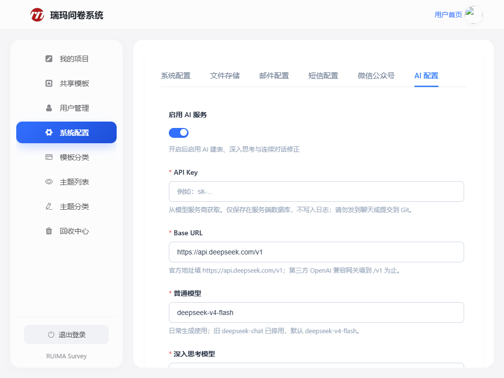
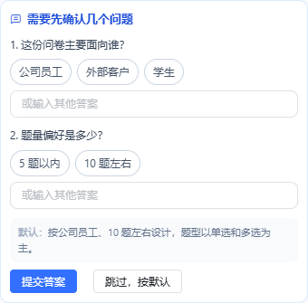
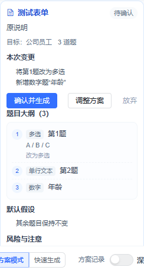
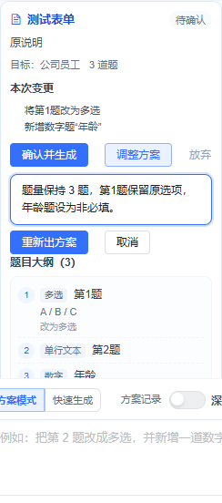
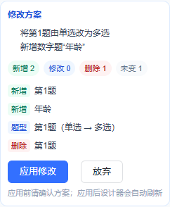
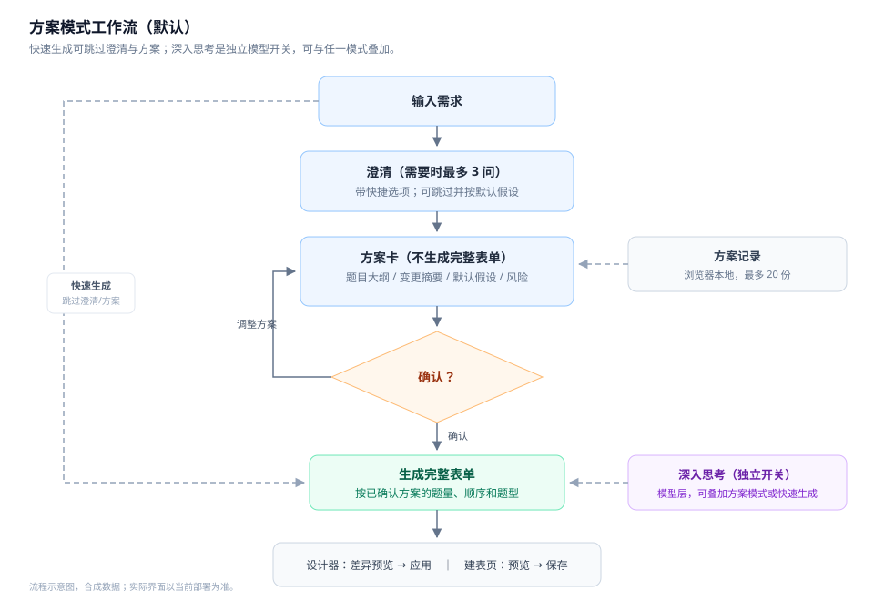
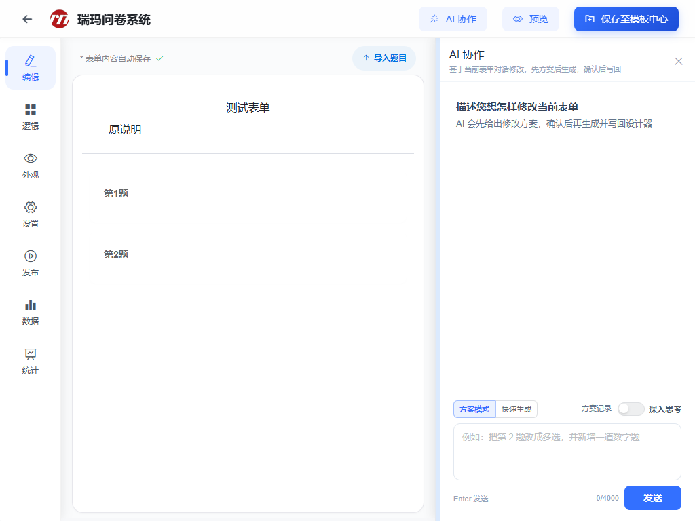

# AI 建表与设计器协作说明

**结论：AI 建表与设计器协作已经可用，默认「方案模式」：需要时最多澄清 3 个问题 → 输出结构化方案 → 用户确认 → 生成完整表单；设计器内确认差异后才写回。** 独立「深入思考」是模型层开关，与方案模式叠加使用；方案按表单/建表页保存在浏览器本地。

**边界：** AI 生成的是普通表单（`fm_user_form`/`fm_user_item`），不会自动创建或发布需求收集单；需要时在「后台管理 → 收集单 → 收集配置」完成收集单配置。API Key 只保存在服务端数据库，本文不记录任何 Key、令牌或完整认证响应。

## 目录

- [一、快速上手](#一快速上手)
- [二、入口与权限](#二入口与权限)
- [三、配置](#三配置)
- [四、方案模式与快速生成](#四方案模式与快速生成)
- [五、深入思考](#五深入思考)
- [六、连续对话与设计器应用](#六连续对话与设计器应用)
- [七、接口与数据](#七接口与数据)
- [八、实现结构](#八实现结构)
- [九、部署与回退](#九部署与回退)
- [十、排障](#十排障)
- [十一、已知限制](#十一已知限制)
- [十二、设计思考与取舍](#十二设计思考与取舍)
- [十三、验证记录](#十三验证记录)
- [十四、参考](#十四参考)

## 一、快速上手

### 1.1 配置 AI

1. 用全局管理员登录，进入「系统配置 → AI 配置」，也可直接打开 `/manage/system?tab=deepSeekEnvConfig`。
2. 打开「启用 AI 服务」，填写 API Key、Base URL、普通模型、深入思考模型、思考强度与超时。
3. 保存后配置立即重建，无需重启；点击「测试连接」验证 Key 与模型。
4. Base URL 使用单斜杠，例如 `https://api.deepseek.com/v1` 或内网兼容网关的 `/v1`；不要写 `//v1`，部分网关会返回 HTML 页面。



*图 1：AI 配置页字段示意，Key 输入框保持为空或不展示；合成数据，仅示意。*

### 1.2 AI 建表

1. 打开「我的项目」，点击「AI 智能建表」。
2. 默认「方案模式」；输入需求后点击发送。信息不足时出现澄清卡，可选项或自定义回答，也可「跳过，按默认」。
3. 方案卡出现后检查题目大纲、变更摘要、默认假设和风险；可「确认并生成」「调整方案」或「放弃」。
4. 生成完成后右侧实时预览；确认无误后「保存表单」。保存成功可跳转设计器，路由带 `ai=1` 会自动打开 AI 协作面板。



*图 2：澄清卡，合成数据，仅示意。*



*图 3：方案卡与确认/调整/放弃操作，合成数据，仅示意。*

### 1.3 设计器 AI 协作

1. 打开表单设计器，点击顶栏「AI 协作」，右侧出现可拖拽平铺面板。
2. 输入修改要求，例如“保留其他题目不变，把‘您常用的沟通方式’改成多选，并新增一道数字题‘每周远程办公天数’”。
3. 按方案卡确认后生成完整表单；差异卡列出新增、修改、删除和未变题目，点击「应用修改」才写回设计器。
4. 应用前会检查表单是否被手动修改；已配置逻辑的表单会额外提醒。应用后设计器自动重新加载。



*图 4：方案调整输入与重新出方案，合成数据，仅示意。*



*图 5：生成后的差异卡与应用修改，合成数据，仅示意。*

### 1.4 方案记录

- 方案卡生成后自动保存在当前浏览器；面板底部「方案记录」可查看标题、时间、状态并复制 Markdown。
- 方案按作用域保存：AI 建表页为 `create`，设计器为 `form:<formKey>`；每个作用域最多 20 份。
- 方案只在本浏览器可见，不跨设备同步；需要跨设备留存时再评估后端表。

## 二、入口与权限

| 能力 | 全局管理员 | 后台管理员 | 普通登录用户 |
|---|---|---|---|
| AI 智能建表（我的项目） | 可用 | 可用 | 不可用 |
| 设计器 AI 协作 | 可用 | 可用 | 不可用 |
| AI 配置（系统配置） | 可用 | 不可用 | 不可用 |
| 修改现有表单（revise） | 全部表单 | 本人创建或 `can_manage` | 不可用 |
| 创建/保存普通表单 | 可用 | 可用 | 按原表单权限 |

- 后端对 `/ai/**` 校验后台管理员或全局管理员；前端隐藏菜单不作为授权依据。
- 修改模式额外校验 `FormAuthUtils.hasPermission(formKey)`，与表单设计器原有权限一致。
- AI 配置保存在 `sys_env_config.deepSeekEnvConfig`，仅全局管理员可维护。

## 三、配置

| 字段 | 默认值 | 说明 |
|---|---|---|
| `enabled` | false | 关闭时清空服务，接口返回明确未启用提示 |
| `apiKey` | 空 | 仅服务端数据库保存；不进入日志、文档、截图或 Git |
| `baseUrl` | `https://api.deepseek.com/v1` | 归一化去尾斜杠、去 `/chat/completions`；只允许 http/https；路径不要写重复斜杠 |
| `modelName` | `deepseek-v4-flash` | 普通模式；旧 `deepseek-chat` 自动迁移 |
| `reasoningModelName` | `deepseek-v4-pro` | 深入思考模式；旧 `deepseek-reasoner` 自动迁移 |
| `reasoningEffort` | `high` | `low/high/max`，仅官方 DeepSeek 域名下发 |
| `timeout` | 300 秒 | 连接与流式读取超时，限制 30-600 秒 |

- 配置保存在数据库 `sys_env_config` 的 `deepSeekEnvConfig`；保存后由 `EnvConfigRefreshEvent` 立即重建服务，无需重启应用。
- 官方 DeepSeek 域名会下发 `response_format`、`thinking` 与 `reasoning_effort`；非官方 OpenAI 兼容网关只切换模型名，不下发专有参数。
- 测试连接会发送极小提示验证 Key 与模型；错误文本会脱敏 `sk-*` 并截断，不返回完整 Key。
- 当前 240 测试实例使用内网 New API 网关，可用模型为 `deepseek-flash`、`deepseek-v4-flash` 等，Base URL 为 `/v1`；真实配置以管理员填写为准，本文不记录 Key。

## 四、方案模式与快速生成

| 模式 | 行为 | 适用 |
|---|---|---|
| 方案模式（默认） | 澄清（需要时最多 3 问）→ 结构化方案 → 确认 → 生成完整表单 | 复杂问卷、设计器修改、需要留痕 |
| 快速生成 | 输入需求直接生成完整表单 | 需求明确、快速出结果 |
| 深入思考 | 模型层开关，使用推理模型并展示思考过程；可与任一模式叠加 | 复杂逻辑、更高质量 |



*图 6：方案模式工作流；快速生成可跳过澄清与方案。*

- **澄清**：只问会显著影响题目结构、题型、题量、考试计分或修改范围的问题；每个问题带快捷选项和自定义输入，可「跳过，按默认」。信息足够时自动进入方案阶段。
- **方案**：只输出结构化方案（标题、目标人群、题量/题型、题目大纲、默认假设、风险、修改模式的变更摘要），不生成完整表单，不写回设计器。
- **确认**：方案卡提供「确认并生成」「调整方案」「放弃」；调整方案只重新生成方案，不触发表单写回。
- **生成**：按确认后的方案生成完整表单；设计器展示差异并要求「应用修改」，建表页更新预览并要求保存。
- **留存**：方案按 `create` 或 `form:<formKey>` 作用域保存在本浏览器，最多 20 份；「方案记录」可查看并复制 Markdown。

| localStorage 键 | 作用 | 默认/范围 |
|---|---|---|
| `ruima.ai.workflow` | 方案模式/快速生成 | `plan` |
| `ruima.ai.thinking` | 深入思考开关 | `0` |
| `ruima.ai.panelWidth` | 设计器面板宽度 | 340，280-420 |
| `ruima.ai.plans` | 方案记录 | 每作用域最多 20 份 |

## 五、深入思考

- 前端开关写入 `localStorage`（`ruima.ai.thinking`），两条 AI 路径共享。
- 开启后使用 `reasoningModelName`；后端把 `reasoning_content` 作为独立 `thinking` 事件下发，界面折叠展示，不参与 JSON 解析。
- 官方 DeepSeek 域名额外下发 `thinking={"type":"enabled"}` 与 `reasoning_effort`；普通模式显式 `thinking={"type":"disabled"}`。
- 非官方 OpenAI 兼容网关只切换模型名，不下发 DeepSeek 专有参数；状态接口用 `thinkingMode=model` 表示。
- 如果网关没有独立的 Pro/Reasoner 模型，深入思考会与普通模式使用同一模型，不会自动变强；但网关返回的 `reasoning_content` 仍会展示。需要更强推理时，在网关新增模型并配置为深入思考模型。
- 第三方网关若用 `<think>...</think>` 包裹思考内容，前端兜底过滤器会拆分。

## 六、连续对话与设计器应用

### 6.1 独立建表页

- 首轮生成后，用户继续输入修改意见；历史中 assistant 的完整 JSON 作为下一轮上下文，当前表单通过 `currentForm` 单独传递。
- 首轮生成中实时预览；修正轮等待输出完整后再替换预览，避免半成品覆盖。
- 保存成功但用户取消跳转时，不提示保存失败；建单成功、题目导入失败时保留 `formKey` 并提供「重试导入」，不重复建单。

### 6.2 设计器 AI 协作

- 面板位于设计器右侧，可拖拽调宽 280-420px（默认 340px），无遮罩；1024×768 下画布约 594px，关闭面板后恢复全宽。
- 每次发送前读取 `/user/form/item/list` 与 `/user/form/{key}`，把当前题目（含 `formItemId`、题型、标题、选项）发给模型。
- 修改模式固定返回 `{ plan, title, description, questions }`；`questions` 是修改后的完整表单。
- 提示词要求：已有题目原样返回 `formItemId`，新增题目不带 ID，`locked: true` 的题目不得修改。
- 应用顺序：更新 → 新建 → 删除 → 标题描述 → 排序；每步失败即停止并报告。
- 应用前重新读取当前表单，签名变化时二次确认；已配置逻辑的表单额外提醒。
- 含不支持题型时不做自动排序，保留原位置并提示人工确认。
- 应用后递增 `router-view` 的 key 重新挂载设计器，不修改 `node_modules` 中的 `tduck-form-generator`。



*图 7：1024×768 右侧平铺面板，合成数据，仅示意。*

### 6.3 数据与收集单

- AI 建表保存为普通表单，写入 `fm_user_form` 与 `fm_user_item`；不会写 `rm_demand_form`，不会自动发布或开放匿名。
- 要成为需求收集单：进入「后台管理 → 收集单」，找到该表单（管理列表包含未配置的普通表单），点击「收集配置」，设置收集说明、可见范围、匿名和发布。
- 后台管理员只能看到本人创建或 `can_manage` 的收集单；AI 建表由当前管理员创建，因此创建人可在管理列表完成配置。
- 原答卷仍是需求正文正本；AI 只改表单结构，不写答卷、不清理已收集数据。

## 七、接口与数据

| 方法 | 路径 | 说明 |
|---|---|---|
| GET | `/ai/status` | 返回是否配置、模型名、思考模式与中文原因；不返回 Key |
| POST | `/ai/gen-form-chat/stream` | 新版流式会话；`mode=create/revise`，`stage=clarify/plan/generate`，支持 `thinking`、`currentForm`、`planJson`、`messages` |
| GET | `/ai/gen-form-chat` | 旧版流式接口，返回原始 OpenAI chunk，`model` 参数忽略 |
| GET | `/ai/test-gen-form` | 同步测试生成，仅管理员 |
| GET | `/ai/test-connection` | 发送极小提示验证 Key 与模型，配置页使用 |

```json
{
  "requestId": "ai-1700000000000-1",
  "mode": "revise",
  "stage": "generate",
  "formKey": "EpA5AG0f",
  "messages": [
    { "role": "user", "content": "把第1题改成多选，并新增年龄题" }
  ],
  "currentForm": "{\"title\":\"测试表单\",\"questions\":[]}",
  "planJson": "{\"title\":\"测试表单\",\"outline\":[]}",
  "thinking": false
}
```

新版 SSE 事件：

| 事件 | 内容 |
|---|---|
| `meta` | 模型、是否思考、历史是否裁剪 |
| `thinking` | `reasoning_content` 增量 |
| `content` | 表单/方案 JSON 增量 |
| `ping` | 15 秒心跳，保持连接 |
| `done` | 结束原因、内容长度、是否截断 |
| `error` | 错误码、中文提示、是否可重试 |

错误码与处理：

| 错误码 | 含义 | 可重试 | 处理 |
|---|---|---|---|
| `AI_NOT_CONFIGURED` | 未启用、缺 Key、URL 非法 | 否 | 管理员完成 AI 配置 |
| `AI_AUTH_FAILED` | 401/403 或 Key 无效 | 否 | 重新填写 Key 并测试连接 |
| `AI_MODEL_NOT_FOUND` | 模型不存在 | 否 | 改用网关可用模型 |
| `AI_RATE_LIMITED` | 429、额度不足 | 是 | 稍后重试 |
| `AI_TIMEOUT` | 读取超时 | 是 | 重试或关闭深入思考、检查超时 |
| `AI_NETWORK_ERROR` | 域名/连接/SSL 失败 | 是 | 检查网络与 Base URL |
| `AI_UPSTREAM_ERROR` | 其他上游错误 | 是 | 稍后重试 |
| `AI_EMPTY_RESULT` | 结束但内容为空（前端本地提示） | 是 | 重试 |

- 参数校验、权限不足、历史硬超限和初始化异常可能由全局异常处理器返回 HTTP 200 的 JSON `Result`（`code` 400/401/403/429/500），前端按 `msg` 展示，不是 SSE 错误事件。
- 历史限制：最多 20 条消息 / 10 轮；单条 user 4000 字符；总字符 100000；超限从旧轮次裁剪，仍超限压缩为「首条需求 + 当前表单 + 最新指令」。
- 认证失败或参数校验错误可能由全局异常处理器返回 HTTP 200 的 JSON `Result`（`code` 400/401/403/429）；前端先判断 `Content-Type`，不是 `text/event-stream` 时按 `msg` 展示。
- 旧 GET 接口保留给已缓存前端；未配置时返回空流，旧前端仍可能静默，新前端使用 POST 接口并展示错误。

## 八、实现结构

前端：

- `src/views/ai/form/ChatForm.vue`：独立建表页，左会话右预览。
- `src/views/ai/form/DesignerChat.vue`：设计器右侧可拖拽平铺面板、差异应用。
- `src/views/ai/form/AiChatPanel.vue`：共享会话 UI、模式切换、方案记录。
- `AiClarifyCard.vue`、`AiPlanCard.vue`：澄清卡与方案卡。
- `aiChatMixin.js`：阶段状态机、历史裁剪、流式事件、留存；`planStore.js`：localStorage 方案记录。
- `formBridge.js`：整表差异与应用；`convertToFields.js`：AI JSON 转设计器字段。
- `src/api/ai.js`、`src/utils/sseStream.js`：POST + fetch 流式客户端；`src/views/form/index.vue`：设计器入口与 `router-view` 重载。

后端：

- `AiController`：`/ai/status`、`/ai/gen-form-chat/stream`、旧 GET、测试连接。
- `AiConfiguration` / `AiConfigSupport` / `AiProperties`：配置读取、服务构建、状态、官方/网关差异。
- `AiHistoryBuilder`：角色校验、历史裁剪、当前表单/方案注入。
- `AiStreamParser` / `AiChatUtils`：SSE 解析、心跳、错误分类、终止条件。
- 提示词：`form-prompt-clarify.md`、`form-prompt-plan.md`、`form-prompt-deepseek.md`、`form-prompt-revise.md`。

数据流：

```text
ChatForm / DesignerChat
  → aiChatMixin（阶段、历史、方案）
  → api/ai.js + sseStream.js（POST SSE）
  → AiController → AiHistoryBuilder → 提示词 → AiChatUtils → 模型网关
  → meta / thinking / content / done / error
  → 澄清卡 / 方案卡 / 差异卡 / 预览
  → 设计器应用 或 保存普通表单
```

## 九、部署与回退

- Nginx 的 `/ai/` 使用独立 location：`proxy_buffering off`、`proxy_cache off`、`proxy_http_version 1.1`、`Connection ""`、读写超时 600 秒、`gzip off`；仓库模板为 `deploy/test240/nginx.conf`，实际文件为 `/www/server/panel/vhost/nginx/ruima-survey-test.conf`，两处必须同步。
- 最小替换顺序：备份 Nginx/旧 JAR/旧静态目录 → 更新 Nginx 并 `nginx -t` reload → 部署后端 JAR → 部署前端静态资源（先资源后 `index.html`，校验 SHA256）→ 管理员填写 Key → 验收。
- 仅前端修复可做静态-only 更新，不重启应用、不改 Nginx；本次方案卡滚动修复即按此方式替换。
- 无数据库结构变更；`deepSeekEnvConfig` 由后台保存时自动创建。
- 240 的备份目录、镜像标签、当前哈希和真实联调记录见 [240 部署说明](../deploy/test240/README.md) 第九、十节。

## 十、排障

| 现象 | 原因 | 处理 |
|---|---|---|
| 显示「AI 服务未配置」 | 未启用、缺 Key、URL 非法 | 管理员完成「系统配置 → AI 配置」 |
| 测试连接报 JSON/XML 解析错误 | Base URL 多斜杠或被网关重定向到 HTML | 改成单斜杠 `/v1`，确认网关地址 |
| 流式请求长时间无输出 | 模型/网关不可达或超时太短 | 检查 Base URL、网关健康、超时与 Nginx 600 秒 |
| 提示模型不可用 | 旧别名或网关未提供该模型 | 改为网关 `/v1/models` 中的模型名 |
| 401/403 | Key 无效或权限不足 | 重新填写 Key，确认表单权限 |
| 429 | 请求过频或额度不足 | 稍后重试，检查网关额度 |
| 方案卡看不到「确认并生成」 | 消息列表滚动位置 | 方案出现会自动滚到卡片顶部；仍不可见时向上滚动 |
| 应用后顺序变化 | 含不支持题型或排序失败 | 按提示手动拖动，保留原题型位置 |
| 应用后逻辑失效 | 删除题目或改题型影响逻辑引用 | 应用后在「逻辑」页检查并修复 |
| 旧页面仍静默失败 | 浏览器缓存了旧 EventSource 代码 | 刷新页面或强制刷新静态资源 |

## 十一、已知限制

- AI 只支持 7 种基础题型：单行文本、多行文本、日期、数字、下拉、单选、多选；其他题型标记 `locked` 并原样保留。
- 改变题型无法安全复用 `formItemId`，前端会删除旧题并新建；方案卡会标注，应用后需检查逻辑。
- 停止生成只关闭本地 SSE，不能中止 Hutool 上游线程与计费；这是当前成本边界。
- 方案记录仅保存在当前浏览器，最多 20 份/作用域，不跨设备同步；没有后端表和审计。
- 多轮历史受 20 条/10 轮/100000 字符限制；超限会裁剪，必要时压缩为「首条需求 + 当前表单 + 最新指令」。
- 配置刷新是单实例 Spring 本地事件；多副本部署需要额外的配置刷新机制。
- 每用户每分钟最多 12 次 AI 请求；没有全局额度或租户配额。
- AI 生成的是普通表单，不会自动配置收集单、发布或开放匿名。

## 十二、设计思考与取舍

### 为什么拆分方案模式与深入思考

方案模式是交互协议：何时提问、何时给方案、何时生成；深入思考是模型质量开关。混在一起会让用户不知道当前等待的是“澄清”还是“模型推理”，延迟和成本也不可预期。拆分后，方案模式负责可控性，深入思考负责质量。

### 为什么按需澄清、最多 3 问

每个问题都增加操作成本。只问会显著改变题目结构、题型、题量、考试计分或修改范围的问题；其余用默认假设写进方案卡，用户可以在调整方案时一次说清。这样既避免盲猜，也避免问卷式盘问。

### 为什么整表重写并保留 ID

让模型输出差异容易漏项、错位，难以校验。整表 JSON 可以先校验、再预览，前端用 `formItemId` 做确定性差异；未改题目保留 ID，继续关联表单逻辑和已收集数据。题型变化无法安全复用 ID，因此删除重建并在方案中标注。

### 为什么确认后才写回

设计器修改是破坏性操作。方案确认、差异确认、冲突检测和逻辑提醒把不可逆操作前置到用户可见的确认点；任何一步失败都停止并报告，不用“模型直接改库”换取速度。

### 为什么方案存浏览器

当前是单管理员测试场景，localStorage 不需要数据库迁移、权限表和跨端同步，代价是本机可见、最多 20 份。需要跨设备或审计时，再评估后端表和清理策略。

### 取舍与场景

| 场景 | 推荐 | 说明 |
|---|---|---|
| 需求明确、只要快速出表单 | 快速生成 | 跳过澄清与方案，直接预览 |
| 复杂问卷或设计器修改 | 方案模式 | 先确认结构，再生成与应用 |
| 逻辑复杂、需要更高质量 | 方案模式 + 深入思考 | 模型层更强，方案仍需人工确认 |
| 只改一题或小范围调整 | 方案模式 | 方案卡会自动轻量，仍保留确认点 |

**核心取舍：** 方案模式多一次方案调用和等待，换来更低的误改风险、可审查的方案和可留存的记录；简单需求可随时切快速生成。

## 十三、验证记录

- 后端：`mvn -B -pl tduck-api -am test` 共 52 项通过（原有 29 项 + AI 新增 23 项：配置工具 4、配置服务 6、历史裁剪 7、流式解析 6）。
- 前端：`npm run build:ruima` 通过；`npm run test:e2e` 共 32 项通过（原有 26 项 + AI 6 项：未配置提示、方案模式全流程、快速生成与深入思考、流式错误、1024 布局、设计器方案确认与拖拽应用）。
- 240 第一次部署（2026-11-15 21:25）：应用镜像 `sha256:8c59736095ae1f4b7a3a7719a408fa69c1cfab0f0fecf8fe62b5639e2d05305e`；JAR `2dd1b0f5…`；`index.html` `8e72e316…`。配置前验证通过。
- 240 第二次部署（2026-11-15 22:23，方案模式与右侧平铺）：应用镜像 `sha256:023c3c601808a14d0be8e58e8723ca228b60ec24dc1f1ca53b9413279ace9b08`；JAR SHA256 `b3c132ce2a4b76bd1fd4d03577f6599db9482db836835ad7e784dc17691bbbb0`；静态资源先部署 `d8fa69db…`，随后因响应式修复最小替换为 `9d54ac23…`，未重启应用、未改 Nginx。
- 240 真实浏览器（1024×768）：建表页未配置横幅、发送禁用、方案模式/快速生成切换、方案记录空态；设计器 AI 面板为右侧平铺，默认 340px，画布 594px，无遮罩，拖拽后 383px，页面无横向溢出；配置页默认 `deepseek-v4-flash`/`deepseek-v4-pro`；页面运行错误与失败请求均为 0。
- 真实 Key 联调（2026-11-15 23:40，内网 New API 网关 `http://192.168.1.236:3000/v1`，模型 `deepseek-flash`）：
  - 首次配置 Base URL 为 `http://192.168.1.236:3000//v1`（多一个斜杠），网关返回 New API 网页 HTML，测试连接报解析错误、流式请求 330 秒超时；保留 Key 不变，仅把 Base URL 规范为 `/v1` 后即时生效。
  - 测试连接 453ms 成功；澄清阶段返回无需提问；方案阶段输出 5 题大纲；生成阶段输出 5 题，与方案一致。
  - 设计器真实协作：创建合成表单（单选“您常用的沟通方式”+ 多行文本“您对远程办公的建议”），方案 3 题；确认生成后应用成功，最终为多选“您常用的沟通方式”、多行文本“您对远程办公的建议”、数字“每周远程办公天数”；未改动的多行文本保留了原 `formItemId`。合成表单与题目按 ID 清理，剩余 0 行。
  - 网关当前只提供 `deepseek-flash`、`deepseek-v4-flash` 等模型，没有独立的 Pro/Reasoner；深入思考开关会使用配置的 `reasoningModelName`，但当前与普通模型相同，因此不会切换到更强模型；网关返回的 `reasoning_content` 仍会展示。需要更强推理时，在网关新增模型并配置为深入思考模型。
- 方案卡出现时前端会自动滚动到卡片顶部，保证「确认并生成」可见；该滚动修复已静态替换到 240（`index.html` SHA256 `4fd3cbca60190cb1d75ba7911e4669524cd572dd658601599a1ef8c63835beb0`），未重启应用。

## 十四、参考

- [瑞玛需求闭环开发与运行说明](瑞玛需求闭环.md)：收集单、需求处理、公示与数据边界。
- [240 独立测试实例部署说明](../deploy/test240/README.md)：部署、Nginx、备份与真实联调记录。
- [前端界面与验证说明](https://github.com/hyperhaohao/tduck-front/blob/haoX/tduck-demand-loop/docs/瑞玛需求界面.md)：AI 建表/协作界面与 1024×768 布局。
- 代码入口：[AiController](../tduck-ai/src/main/java/com/tduck/cloud/ai/controller/AiController.java)、[AiConfiguration](../tduck-ai/src/main/java/com/tduck/cloud/ai/config/AiConfiguration.java)、[DesignerChat](https://github.com/hyperhaohao/tduck-front/blob/haoX/tduck-demand-loop/src/views/ai/form/DesignerChat.vue)。
